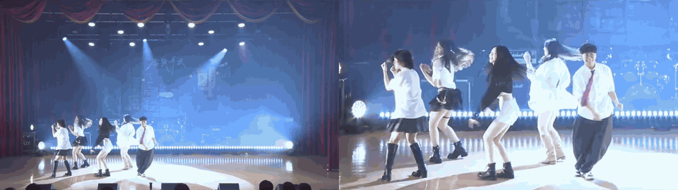

# StageLens — AI Edge Director for Stage Performances

> One fixed camera + one edge AI accelerator → near-professional stage footage, in real time, with no camera operator and no cloud.

<!-- TODO: replace with a before/after GIF (left: raw footage, right: StageLens output) -->


**Demo video:** <!-- TODO: YouTube link (set to "Unlisted / anyone with the link") -->
**Competition:** 2026 ASUS UGen AI League — Creator AI × Battlefield Lightning (ASUS UGen300 AI Accelerator)

---

## Table of Contents

- [The Problem](#the-problem)
- [Our Solution](#our-solution)
- [Why Edge AI](#why-edge-ai)
- [System Architecture](#system-architecture)
- [Quick Start](#quick-start)
- [Project Status](#project-status)
- [Performance](#performance)
- [Models](#models)
- [Repository Structure](#repository-structure)
- [Roadmap](#roadmap)
- [Responsible Use](#responsible-use)
- [Team](#team)
- [License](#license)

---

## The Problem

School shows, dance studio recitals, club performances and small theater productions are almost always recorded the same way: **one camera, fixed at the back of the audience, pointed at the stage.** The result rarely looks like what the audience actually saw.

| Pain point | Why it happens | What viewers see |
|---|---|---|
| **Washed-out faces ("吃妝")** | Strong, flat front lighting + limited camera dynamic range | Over-exposed faces, makeup and facial expression lost |
| **Movements look small** | Long distance + wide angle + frontal view compresses depth | Dancers become tiny figures; big moves lose their impact |

For performers, this footage is often their portfolio — for school applications, auditions and social media. For organizers, it is promotional material. Yet most of these events cannot afford a professional camera operator, a multi-camera setup, or post-production.

Existing tools do not fit this scenario well: phone auto-framing is designed for a single person at close range, and PTZ auto-tracking cameras require replacing existing equipment. Neither is built for **strong stage light, long distance, multiple performers and full-body motion.**

## Our Solution

StageLens is an edge AI box that sits between an existing camera and the recorder/stream. It acts as a **virtual director**.

### Feature A — AI Auto-Framing

- Detects performers and estimates their full-body pose in every frame.
- Computes a target crop around the performer(s), widening for group formations and tightening on big movements (jumps, spins, extended limbs).
- Smooths the virtual camera path (EMA + dead-zone + speed limits) so the output feels like a human operator, not a jittery tracker.

### Feature B — Stage Lighting Restoration

- Locates faces and bodies, then applies **local** exposure and tone correction only to the performers — the set and stage lighting design are left untouched.
- Goal: **restore what the audience saw with their own eyes**, not beautify. No face reshaping, no skin smoothing, no makeup changes.

### How it is used

1. Connect the camera (HDMI capture card or USB) to the StageLens box.
2. Press start.
3. Record or stream the directed output. No operator needed.

## Why Edge AI

| Requirement | Why the cloud does not work well |
|---|---|
| **Real-time, low latency** | Auto-framing must react within frames; round-trips to the cloud add delay and jitter |
| **Works offline** | School halls and community venues often have no stable uplink for high-bitrate video |
| **Privacy** | Footage frequently contains students and minors; processing locally means raw video never leaves the venue |
| **Cost** | No per-minute cloud GPU fees; one-time hardware cost suitable for schools |

The ASUS UGen300 (Hailo-10H, up to 40 TOPS INT4, 8 GB dedicated memory, M.2 or USB) fits this exactly: it offloads detection, pose estimation and segmentation from the host CPU so a small, low-power box can run the full pipeline.

## System Architecture

<!-- TODO: replace with the same diagram used in the proposal deck -->


```
 Camera ──► Capture (HDMI/USB) ──► Host PC / mini PC
                                       │
                         ┌─────────────┴──────────────┐
                         │      ASUS UGen300 (NPU)    │
                         │  • Person detection        │
                         │  • Pose estimation         │
                         │  • Person / face segment.  │
                         └─────────────┬──────────────┘
                                       │ keypoints, boxes, masks
                         ┌─────────────┴──────────────┐
                         │        Host CPU            │
                         │  • Framing logic + smoothing│
                         │  • Local tone correction   │
                         │  • Overlay / encode        │
                         └─────────────┬──────────────┘
                                       ▼
                         Record (MP4) / Live stream (RTMP)
```

**Pipeline per frame**

1. `capture` — read frame from camera, capture card or video file.
2. `detection` — person detection + pose keypoints.
3. `framing` — choose subject(s), compute target crop, smooth camera path, crop & upscale.
4. `lighting` — face/person mask → local exposure compression + contrast recovery (e.g. CLAHE on luminance within mask, feathered blend).
5. `overlay` — optional debug view: skeletons, boxes, crop window, FPS, latency.
6. `output` — write file or push stream.

See [`docs/pipeline.md`](docs/pipeline.md) for details.

## Quick Start

> Stage I prototype runs on a regular PC (CPU or GPU). The UGen300 backend is planned for Stage II — see [Roadmap](#roadmap).

### Requirements

- Python 3.10+
- Windows / Linux / macOS
- Optional: NVIDIA GPU for faster prototyping

### Install

```bash
git clone https://github.com/<your-account>/stagelens.git
cd stagelens
python -m venv .venv
source .venv/bin/activate        # Windows: .venv\Scripts\activate
pip install -r requirements.txt
python scripts/download_models.py
```

### Run

```bash
# Process a video file, show side-by-side debug view
python src/main.py --input samples/demo.mp4 --view split --debug

# Use a live camera (device 0) and save the directed output
python src/main.py --input 0 --output out/stage.mp4

# Only auto-framing, lighting restoration disabled
python src/main.py --input samples/demo.mp4 --no-lighting
```

### Main options

| Option | Default | Description |
|---|---|---|
| `--input` | — | Video file path or camera index |
| `--output` | none | Output video path |
| `--view` | `output` | `output`, `split` (raw vs. directed), or `debug` |
| `--debug` | off | Draw skeletons, boxes, crop window, FPS/latency |
| `--no-lighting` | off | Disable lighting restoration |
| `--backend` | `cpu` | Inference backend: `cpu`, `cuda`, `hailo` (Stage II) |
| `--zoom-max` | `2.5` | Maximum virtual zoom factor |
| `--smooth` | `0.15` | Camera path smoothing (lower = smoother) |

## Project Status

| Component | Status |
|---|---|
| Video / camera input | <!-- TODO --> ⬜ Planned / 🟨 In progress / ✅ Done |
| Pose estimation (PC) | <!-- TODO --> |
| Auto-framing + smoothing | <!-- TODO --> |
| Face lighting restoration | <!-- TODO --> |
| Split-screen debug view | <!-- TODO --> |
| UGen300 (Hailo) backend | ⬜ Stage II |
| Multi-performer focus selection | ⬜ Stage II |
| Live stream output (RTMP) | ⬜ Stage II |
| Automatic highlight clips | ⬜ Stage II |

## Performance

> Measured on the Stage I prototype. Numbers are updated as development continues; UGen300 results will be added in Stage II.

| Platform | Input | Pipeline | FPS | End-to-end latency |
|---|---|---|---|---|
| <!-- TODO: e.g. laptop CPU model --> | 1080p | framing only | TBD | TBD |
| <!-- TODO --> | 1080p | framing + lighting | TBD | TBD |
| ASUS UGen300 (Stage II) | 1080p | full pipeline | target ≥ 30 | target ≤ 100 ms |

Test conditions, scripts and raw logs: [`docs/benchmarks.md`](docs/benchmarks.md).

## Models

| Task | Model | Source | License |
|---|---|---|---|
| Person detection + pose | <!-- TODO: e.g. RTMPose / RTMO --> | <!-- link --> | Apache-2.0 |
| Face detection | <!-- TODO: e.g. MediaPipe Face Detection --> | <!-- link --> | Apache-2.0 |
| Person segmentation | <!-- TODO --> | <!-- link --> | <!-- TODO --> |

We deliberately prefer permissively licensed models so StageLens can be deployed commercially. Model weights are not stored in this repository; `scripts/download_models.py` fetches them. For Stage II, models will be compiled to Hailo HEF format (see [`hardware/ugen300_port.md`](hardware/ugen300_port.md)).

## Repository Structure

```
stagelens/
├── README.md
├── LICENSE
├── requirements.txt
├── scripts/
│   └── download_models.py
├── docs/
│   ├── architecture.png
│   ├── pipeline.md
│   ├── models.md
│   ├── benchmarks.md
│   └── roadmap.md
├── src/
│   ├── capture/
│   ├── detection/
│   ├── framing/
│   ├── lighting/
│   ├── overlay/
│   └── main.py
├── hardware/
│   ├── setup.md
│   └── ugen300_port.md
├── samples/
└── assets/
```

## Roadmap

**Stage I (by 2026/10/14)** — PC prototype
- Auto-framing with smoothed virtual camera
- Face lighting restoration
- Split-screen demo video and proposal

**Stage II (2026/11/6 – 12/4)** — UGen300 integration
- Compile detection / pose / segmentation models to HEF and run on UGen300
- Measure FPS, latency and power on the target hardware
- Multi-performer focus selection (who is the current lead?)
- Live stream output (RTMP) and automatic highlight clips
- Packaged "plug in and press start" box for schools and dance studios

## Responsible Use

- **Restoration, not alteration.** Lighting restoration only compensates for camera exposure limits. StageLens does not change faces, bodies or performances.
- **Consent.** Everyone appearing in the sample footage in this repository has given written consent. Users of StageLens should follow the recording policies of their venue and obtain consent from performers (or guardians of minors).
- **Local by default.** StageLens processes video on-device and does not upload footage anywhere.
- Sample footage uses royalty-free music only.

## Team

| Name | Role |
|---|---|
| <!-- TODO --> | Hardware integration, system architecture |
| <!-- TODO --> | <!-- TODO --> |

Contact: <!-- TODO: team email -->

## License

<!-- TODO: choose a license, e.g. Apache-2.0, and add the LICENSE file -->
This project is licensed under the Apache License 2.0 — see [LICENSE](LICENSE). Third-party models are subject to their own licenses listed in [Models](#models).
